# Trendz Tracker — Teacher Role Schema & Permission Contract Documentation

**Version:** 1.0 (Phase 18)  
**Status:** Repository Documentation & Design Contract  
**Target Environment:** PostgreSQL 15+ / Supabase  

---

## 1. Executive Summary & Design Principles

This specification introduces a first-class **Teacher** role (`role = 'teacher'`) and a dedicated **Teacher Workspace** in Trendz Tracker while maintaining strict boundaries:
- **No privilege escalation:** Existing accounts with `level = 'Teacher'` are strictly students/unprivileged unless an administrator explicitly creates or assigns a teacher account. Accounts are never converted or privileged based on level, name, or student code.
- **Scope isolation:** Teachers can ONLY view, mark, or manage data for **explicitly assigned students** (`teacher_student_assignments`). Unassigned students are completely invisible and protected across all RLS policies, RPCs, and APIs.
- **Granular permissions:** 10 independent permissions govern teacher capabilities, all enabled by default upon creation but individually revocable by administrators. Revocation takes effect immediately without relying on stale client caches.
- **Workflow safeguards:**
  - Attendance corrections by teachers are bounded to the **current India date and the preceding 7 calendar days**. All changes outside this window require an administrator.
  - Teachers **cannot directly correct or delete scores**. Instead, they submit a **Score Correction Request** with an immutable snapshot of the original score and a reason, which administrators review and approve/reject with concurrency conflict detection.
  - Content (announcements, resources, tasks, and weekly tests) authored by teachers must have server-validated assigned recipients and cannot be overwritten or deleted by other teachers or academy-wide.
  - Teacher deactivation immediately revokes all system access while preserving all historical attendance, reviews, audit trails, and messages.

---

## 2. Relational Schema & Tables

### 2.1 Table: `public.profiles` (Constraint Modification)
Existing definition in `01_phase1_schema.sql`:
```sql
ALTER TABLE public.profiles
  DROP CONSTRAINT IF EXISTS profiles_role_check;

ALTER TABLE public.profiles
  ADD CONSTRAINT profiles_role_check
  CHECK (role IN ('student', 'teacher', 'admin'));
```

### 2.2 Table: `public.teacher_student_assignments`
Establishes an explicit many-to-many assignment model between teachers and students. Multiple teachers may be assigned to the same student.
```sql
CREATE TABLE IF NOT EXISTS public.teacher_student_assignments (
  id UUID PRIMARY KEY DEFAULT gen_random_uuid(),
  teacher_id UUID NOT NULL REFERENCES public.profiles(id) ON DELETE CASCADE,
  student_id UUID NOT NULL REFERENCES public.profiles(id) ON DELETE CASCADE,
  assigned_by UUID REFERENCES public.profiles(id) ON DELETE SET NULL,
  created_at TIMESTAMPTZ NOT NULL DEFAULT timezone('utc'::text, now()),
  CONSTRAINT uq_teacher_student_assignment UNIQUE (teacher_id, student_id)
);

CREATE INDEX IF NOT EXISTS idx_teacher_assignments_teacher ON public.teacher_student_assignments(teacher_id);
CREATE INDEX IF NOT EXISTS idx_teacher_assignments_student ON public.teacher_student_assignments(student_id);
```

### 2.3 Table: `public.teacher_permissions`
Stores the 10 granular permissions for each teacher account:
```sql
CREATE TABLE IF NOT EXISTS public.teacher_permissions (
  teacher_id UUID PRIMARY KEY REFERENCES public.profiles(id) ON DELETE CASCADE,
  can_view_students BOOLEAN NOT NULL DEFAULT true,
  can_mark_attendance BOOLEAN NOT NULL DEFAULT true,
  can_correct_attendance BOOLEAN NOT NULL DEFAULT true,
  can_generate_reports BOOLEAN NOT NULL DEFAULT true,
  can_manage_tasks BOOLEAN NOT NULL DEFAULT true,
  can_manage_tests BOOLEAN NOT NULL DEFAULT true,
  can_publish_announcements BOOLEAN NOT NULL DEFAULT true,
  can_manage_resources BOOLEAN NOT NULL DEFAULT true,
  can_review_scores BOOLEAN NOT NULL DEFAULT true,
  can_request_corrections BOOLEAN NOT NULL DEFAULT true,
  updated_at TIMESTAMPTZ NOT NULL DEFAULT timezone('utc'::text, now()),
  updated_by UUID REFERENCES public.profiles(id) ON DELETE SET NULL
);
```

### 2.4 Table: `public.score_correction_requests`
Maintains pending, approved, and rejected score correction requests submitted by teachers. Captures an immutable snapshot of the original score for conflict detection.
```sql
CREATE TABLE IF NOT EXISTS public.score_correction_requests (
  id UUID PRIMARY KEY DEFAULT gen_random_uuid(),
  teacher_id UUID NOT NULL REFERENCES public.profiles(id) ON DELETE CASCADE,
  student_id UUID NOT NULL REFERENCES public.profiles(id) ON DELETE CASCADE,
  result_id UUID REFERENCES public.results(id) ON DELETE CASCADE,
  activity_result_id UUID REFERENCES public.activity_results(id) ON DELETE CASCADE,
  table_name TEXT NOT NULL CHECK (table_name IN ('results', 'activity_results')),
  original_score_snapshot JSONB NOT NULL,
  proposed_correct INTEGER CHECK (proposed_correct >= 0),
  proposed_total INTEGER CHECK (proposed_total >= 0),
  proposed_time_seconds INTEGER CHECK (proposed_time_seconds >= 0),
  reason TEXT NOT NULL CHECK (char_length(trim(reason)) >= 3),
  status TEXT NOT NULL DEFAULT 'pending' CHECK (status IN ('pending', 'approved', 'rejected')),
  decided_by UUID REFERENCES public.profiles(id) ON DELETE SET NULL,
  decided_at TIMESTAMPTZ,
  decision_note TEXT,
  created_at TIMESTAMPTZ NOT NULL DEFAULT timezone('utc'::text, now()),
  CONSTRAINT chk_proposed_correct_lte_total CHECK (
    proposed_correct IS NULL OR proposed_total IS NULL OR proposed_correct <= proposed_total
  )
);

CREATE INDEX IF NOT EXISTS idx_correction_req_status ON public.score_correction_requests(status);
CREATE INDEX IF NOT EXISTS idx_correction_req_student ON public.score_correction_requests(student_id);
CREATE INDEX IF NOT EXISTS idx_correction_req_teacher ON public.score_correction_requests(teacher_id);
```

### 2.5 Table: `public.attendance_audit`
Records every insertion, update, and deletion of attendance rows, including actor, previous values, and timestamp.
```sql
CREATE TABLE IF NOT EXISTS public.attendance_audit (
  id UUID PRIMARY KEY DEFAULT gen_random_uuid(),
  attendance_id UUID,
  session_id UUID NOT NULL,
  student_id UUID NOT NULL REFERENCES public.profiles(id) ON DELETE CASCADE,
  changed_by UUID NOT NULL REFERENCES public.profiles(id),
  action TEXT NOT NULL CHECK (action IN ('mark', 'correct', 'delete')),
  old_status TEXT,
  new_status TEXT,
  old_note TEXT,
  new_note TEXT,
  reason TEXT,
  changed_at TIMESTAMPTZ NOT NULL DEFAULT timezone('utc'::text, now())
);

CREATE INDEX IF NOT EXISTS idx_attendance_audit_student ON public.attendance_audit(student_id);
CREATE INDEX IF NOT EXISTS idx_attendance_audit_session ON public.attendance_audit(session_id);
```

### 2.6 Table: `public.teacher_audit_log`
Tracks administrative operations on teacher accounts (creation, activation, deactivation, password reset, assignment changes, and permission changes).
```sql
CREATE TABLE IF NOT EXISTS public.teacher_audit_log (
  id UUID PRIMARY KEY DEFAULT gen_random_uuid(),
  teacher_id UUID NOT NULL REFERENCES public.profiles(id) ON DELETE CASCADE,
  actor_id UUID NOT NULL REFERENCES public.profiles(id),
  action TEXT NOT NULL CHECK (action IN (
    'create_teacher',
    'update_permissions',
    'assign_students',
    'unassign_students',
    'activate',
    'deactivate',
    'reset_password'
  )),
  details JSONB NOT NULL,
  created_at TIMESTAMPTZ NOT NULL DEFAULT timezone('utc'::text, now())
);

CREATE INDEX IF NOT EXISTS idx_teacher_audit_teacher ON public.teacher_audit_log(teacher_id);
```

### 2.7 Audience Targeting Tables for Teacher Content
Ensure that teacher-created content targets explicitly assigned students rather than broadcast academy-wide:
- `public.weekly_test_recipients (test_id UUID, student_id UUID, PRIMARY KEY (test_id, student_id))`
- `public.daily_task_recipients (task_id UUID, student_id UUID, PRIMARY KEY (task_id, student_id))`
- `public.announcement_recipients (announcement_id UUID, student_id UUID, PRIMARY KEY (announcement_id, student_id))`
- `public.resource_recipients (resource_id UUID, student_id UUID, PRIMARY KEY (resource_id, student_id))`

---

## 3. SQL Security & Helper Functions (SECURITY DEFINER)

All privileged operations evaluate database state directly, preventing bypass via forged client tokens or stale local caches.

1. **`public.is_teacher(p_uid UUID DEFAULT auth.uid()) RETURNS BOOLEAN`**:
   Checks whether `p_uid` has `role = 'teacher'` and `active = true` in `public.profiles`.

2. **`public.is_teacher_assigned_to_student(p_teacher_id UUID, p_student_id UUID) RETURNS BOOLEAN`**:
   Returns true if an active assignment exists in `public.teacher_student_assignments`.

3. **`public.has_teacher_permission(p_teacher_id UUID, p_permission TEXT) RETURNS BOOLEAN`**:
   Inspects the corresponding boolean column in `public.teacher_permissions`.

4. **`public.teacher_has_student_access(p_student_id UUID, p_permission TEXT DEFAULT NULL) RETURNS BOOLEAN`**:
   - If caller is `admin`: returns `true`.
   - If caller is `teacher`: verifies caller is active, assigned to `p_student_id`, and has `p_permission` (if specified).
   - Otherwise: returns `false`.

---

## 4. Workflows & State Machine Contracts

### 4.1 Attendance Management
- **Allowed Window:** A teacher may only insert or update attendance records for sessions where:
  $$\text{public.today\_ist()} - 7 \le \text{session\_date} \le \text{public.today\_ist()}$$
- Sessions older than 7 calendar days or dated in the future cannot be modified by teachers (must be handled by admins).
- When a teacher marks or corrects attendance:
  - Every student in the payload MUST be currently assigned to the teacher.
  - The teacher MUST possess `can_mark_attendance` (for first-time marking) or `can_correct_attendance` (for modifying existing records).
  - Every write triggers an immutable insert into `public.attendance_audit`.

### 4.2 Score Review & Verification
- Teachers with `can_review_scores` can call `teacher_verify_scores` or `teacher_flag_score`.
- The server validates that all referenced scores belong to currently assigned students.
- All verification and flag operations write to `public.result_audit` recording `changed_by = teacher_id`.

### 4.3 Score Correction Requests (Approval State Machine)

```mermaid
stateDiagram-v2
    [*] --> Pending: Teacher submits correction request\n(Snapshot captured)
    Pending --> Approved: Admin approves\n(Validates no intermediate score mutations)
    Pending --> Rejected: Admin rejects\n(With decision note)
    Approved --> [*]: Score updated & verified;\naudit log written
    Rejected --> [*]: Request archived;\nno score change
```

- **Concurrency Guard:** During approval, `admin_decide_score_correction` executes `SELECT ... FOR UPDATE` on the target score. If the current score's `correct`, `total`, `time_seconds`, or `updated_at` has drifted from `original_score_snapshot`, the RPC aborts with an error requiring fresh teacher review.
- Teachers are barred from approving their own or any other teacher's correction requests.

### 4.4 Private Messaging & Feedback
- The existing `admin_send_student_message` RPC and `student_messages` table are extended:
  - Active teachers with `can_review_scores` may send private feedback to assigned students.
  - The teacher's actual UUID is recorded as `sender_id`.
  - Attempts to message an unassigned student are rejected with `ERRCODE = '42501'`.

---

## 5. Client Navigation & Route Guards

### 5.1 Route Guards (`js/guard.js`)
- `requireAuth(['admin', 'teacher'])` permits both administrators and teachers.
- If a teacher attempts to access an admin-only page (e.g., `/pages/admin.html`, `/pages/backup.html`, `/pages/import.html`, `/pages/categories.html`, `/pages/targets.html`, `/pages/competition.html`), the route guard immediately redirects to `/pages/teacher.html` without rendering any admin controls.

### 5.2 Teacher Primary Navigation (`js/navConfig.js`)
1. **Overview** (`/pages/teacher.html`)
2. **My Students** (`/pages/students.html`)
3. **Attendance** (`/pages/attendance.html`) — hidden if `can_mark_attendance` is false.
4. **Tasks** (`/pages/todos.html`) — hidden if `can_manage_tasks` is false.
5. **Weekly Tests** (`/pages/weekly-tests.html`) — hidden if `can_manage_tests` is false.
6. **Review** (`/pages/review.html`) — hidden if `can_review_scores` is false.
7. **Monthly Reports** (`/pages/monthly-report.html`) — hidden if `can_generate_reports` is false.
8. **Class Content ▾** (`/pages/announcements.html` & `/pages/resources.html`) — hidden if both content permissions are false.
9. **Account** & **Sign out**
