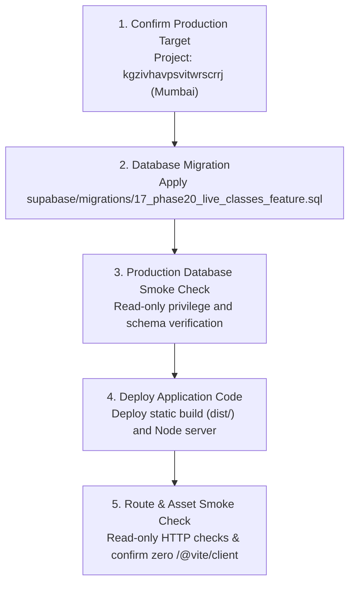

# Live Classes & Webinar.gg Integration Production Release Runbook
Phase 20 — Trendz Tracker

## 1. Environment & Target Isolation Notice

- **Production Project**: `kgzivhavpsvitwrscrrj` (AWS `ap-south-1` Mumbai).
- **Dedicated Staging**: `xhgzbbkvwojwfbexvcmh`.
- **CRITICAL SECURITY REQUIREMENT**: `scripts/verify-staging-api.js` is **STAGING-ONLY**. It authenticates using staging accounts (`stg-001@trendz.local`, etc.). **NEVER execute `scripts/verify-staging-api.js` against Mumbai/production** and **NEVER send staging credentials to production**.

---

## 2. Forward Rollout Order



### Step 1: Pre-Migration Target Confirmation
Before connecting, ensure the active connection is explicitly pointing to production:
```sql
SELECT current_database(), current_setting('request.jwt.claim.iss', true);
```
Confirm the host URL corresponds to `kgzivhavpsvitwrscrrj.supabase.co`.

### Step 2: Database Migration
Apply the forward migration:
- File: `supabase/migrations/17_phase20_live_classes_feature.sql`
- *Note*: Rollback scripts are located in `supabase/rollbacks/` and are excluded from normal migration runs.

### Step 3: Production Database Smoke Check (Read-Only SQL)
Run the following read-only SQL queries to verify schema and effective table privileges without modifying any data:

#### A. Table & Column Verification
```sql
SELECT column_name, data_type, is_nullable
FROM information_schema.columns
WHERE table_schema = 'public' AND table_name = 'live_classes'
ORDER BY ordinal_position;
```
Confirm required columns exist, specifically `host_email` (`TEXT`, nullable) and `invited_teacher_ids` (`JSONB`, nullable).

#### B. Trigger & Function Verification
```sql
-- Confirm trigger
SELECT trigger_name, event_manipulation, action_statement
FROM information_schema.triggers
WHERE event_object_table = 'live_classes' AND trigger_name = 'trg_live_classes_admin_only_fields';

-- Confirm security definer RPC
SELECT routine_name, security_type
FROM information_schema.routines
WHERE routine_schema = 'public' AND routine_name = 'get_eligible_live_classes_for_student';
```

#### C. Effective Table Privilege Verification
```sql
SELECT
  r.rolname,
  has_table_privilege(r.rolname, 'public.live_classes', 'SELECT') AS can_select,
  has_table_privilege(r.rolname, 'public.live_classes', 'INSERT') AS can_insert,
  has_table_privilege(r.rolname, 'public.live_classes', 'UPDATE') AS can_update,
  has_table_privilege(r.rolname, 'public.live_classes', 'DELETE') AS can_delete,
  has_table_privilege(r.rolname, 'public.live_classes', 'TRUNCATE') AS can_truncate,
  has_table_privilege(r.rolname, 'public.live_classes', 'REFERENCES') AS can_references,
  has_table_privilege(r.rolname, 'public.live_classes', 'TRIGGER') AS can_trigger
FROM (VALUES ('anon'), ('authenticated'), ('service_role')) AS r(rolname);
```
**Expected Results**:
- `anon`: all `false`.
- `authenticated`: `SELECT`, `INSERT`, `UPDATE`, `DELETE` = `true`; `TRUNCATE`, `REFERENCES`, `TRIGGER` = `false`.
- `service_role`: all `true`.

#### D. Routine Execution Privilege Verification
```sql
SELECT
  r.rolname,
  has_function_privilege(r.rolname, 'public.get_eligible_live_classes_for_student(uuid)', 'EXECUTE') AS can_execute
FROM (VALUES ('anon'), ('authenticated'), ('service_role')) AS r(rolname);
```
**Expected Results**:
- `anon`: `false`.
- `authenticated`: `true`.
- `service_role`: `true`.

### Step 4: Deploy Application Code & Assets
1. Build production static bundle: `npm run build`
2. Deploy backend service (`server.ts`, `api/_liveClass.js`) and static output (`dist/`).

### Step 5: Route & Asset Smoke Check (Read-Only HTTP)
Perform read-only HTTP GET requests against the production origin (no credentials transmitted):
1. **Config endpoint**:
   - `GET /api/config` -> HTTP 200, `supabaseUrl` origin is `https://kgzivhavpsvitwrscrrj.supabase.co`.
2. **Static routes**:
   - `GET /pages/live-room.html` -> HTTP 200.
   - `GET /pages/live-classes.html` -> HTTP 200.
   - `GET /pages/student.html` -> HTTP 200.
   - `GET /index.html` -> HTTP 200.
3. **Asset inspection**:
   - Verify served HTML files contain **zero references to `/@vite/client`**.

---

## 3. Rollback Procedures & Sequencing

### Scenario A: Application Rollback (Primary & Default)
If a frontend display glitch, client session recovery defect, or cosmetic regression occurs:
1. **Restore previous app deployment first**:
   - Revert deployment to previous known-good production commit (e.g. `c3b4a0f` on `main`).
2. **Leave database untouched**:
   - Migration 17 is backward-compatible. Older application code does not reference live classes, and the table and trigger remain safely idle.
   - All existing class rows and historical webinar mappings remain preserved.

### Scenario B: Manual Database Rollback (Emergency Only)
**When to use**:
- ONLY if the database trigger, function, or RLS policies cause severe unexpected database-level locking or errors; AND
- The application deployment has **already been rolled back first** (Scenario A) so that active user traffic to live class routes has ceased.

**Execution**:
1. Confirm the application rollback is live and no traffic is hitting live room endpoints.
2. Execute the manual rollback script:
   - File: `supabase/rollbacks/17_phase20_live_classes_feature_rollback.sql`
3. **Safety Verification**:
   - The rollback script drops the trigger `trg_live_classes_admin_only_fields`, function `enforce_live_class_admin_only_fields()`, RPC `get_eligible_live_classes_for_student()`, and student/teacher RLS policies.
   - It **NEVER drops or truncates `public.live_classes`**.
   - Verify record retention:
     ```sql
     SELECT count(*) FROM public.live_classes;
     ```
     Ensure all existing class rows, host emails, and webinar IDs remain intact.
